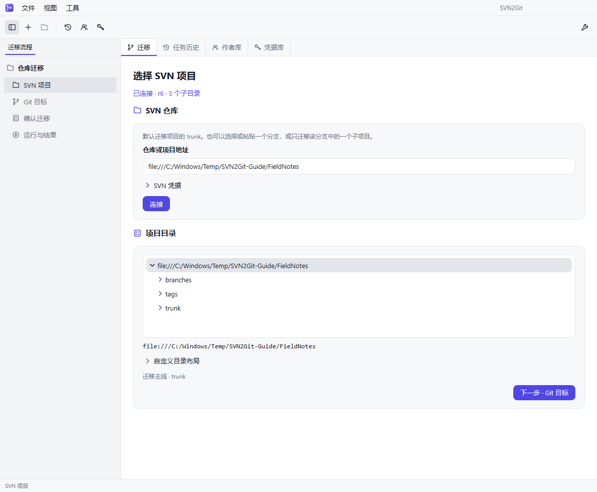
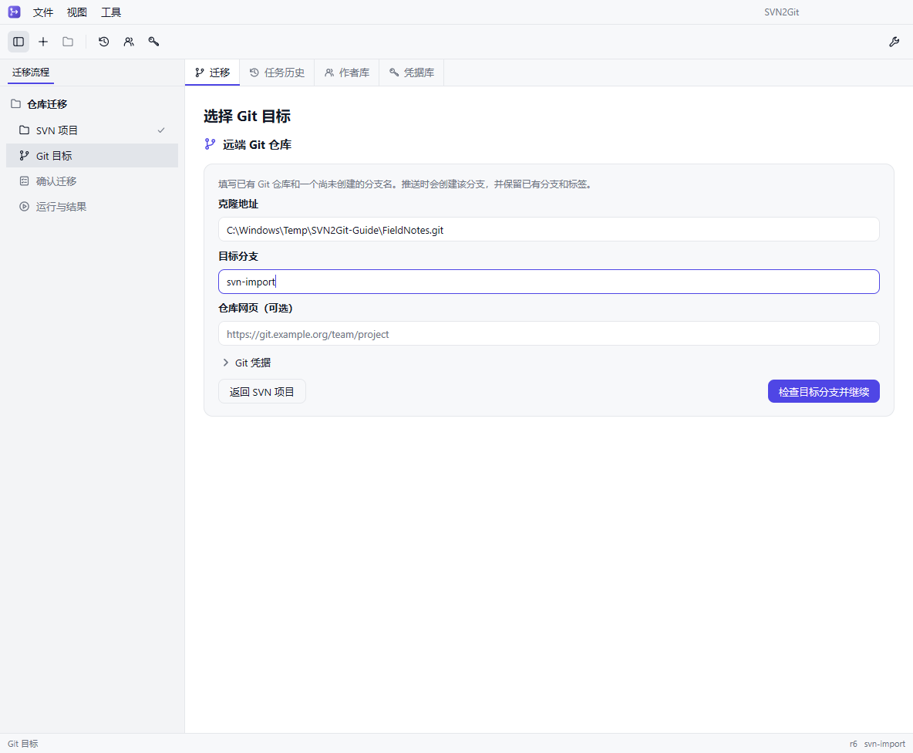
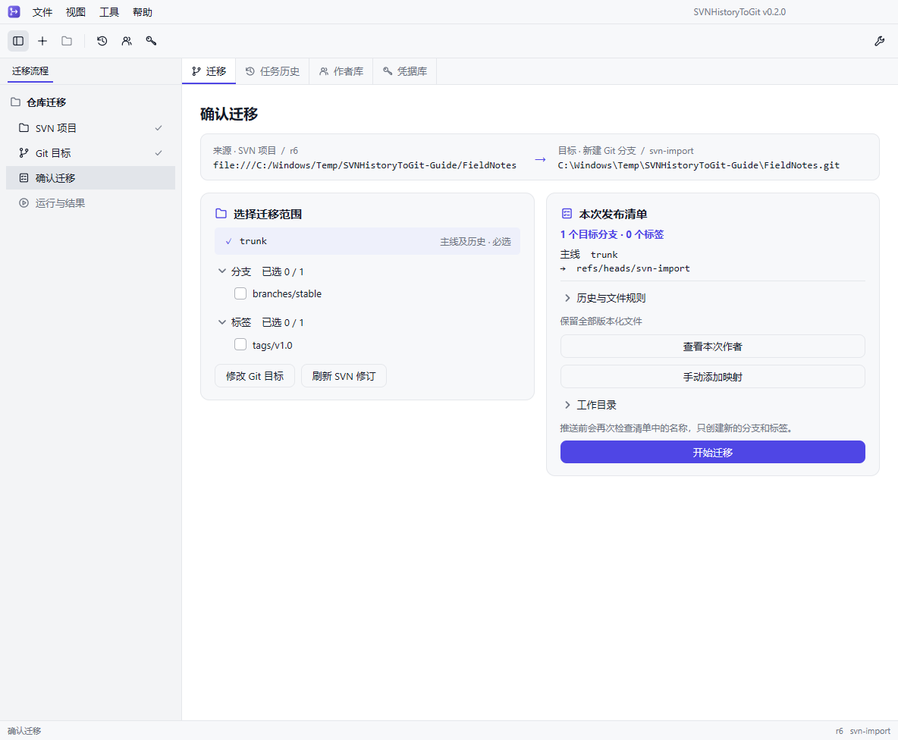
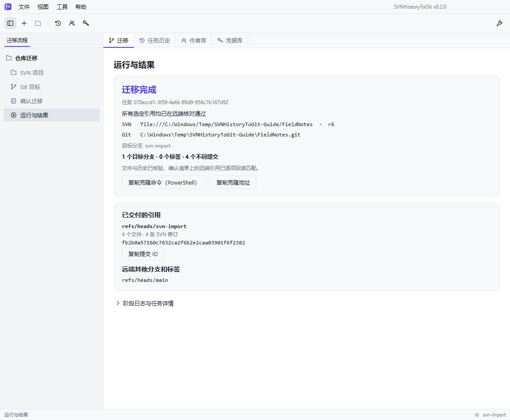
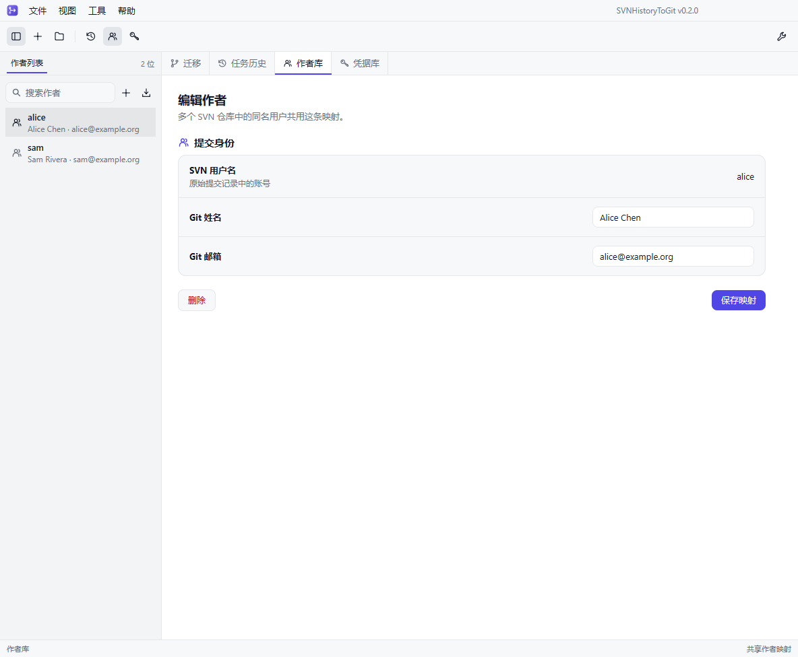
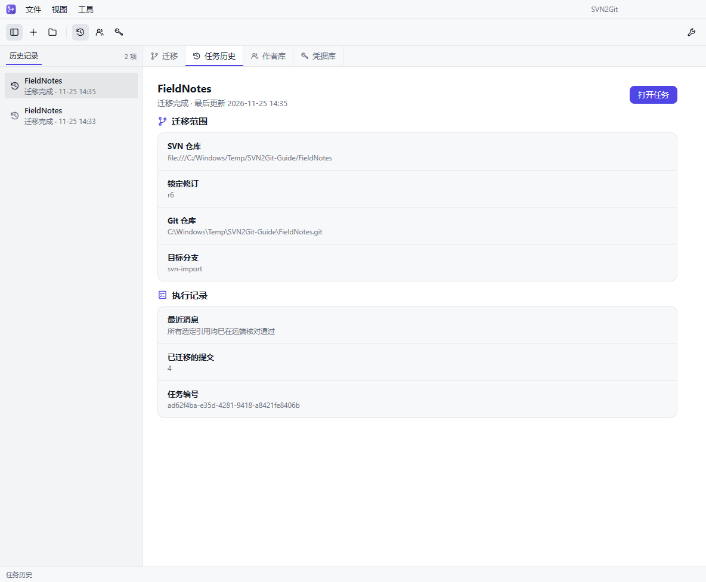

# [SVNHistoryToGit](https://github.com/edisonluc/SVNHistoryToGit)

[简体中文](README.md) · English

SVNHistoryToGit is a Windows desktop tool for moving an SVN project's files and commit history into a new branch of an existing Git repository. The native MyGo wizard shows the destination for each SVN path. The Rust engine converts the history, verifies the files and checks each reference on the remote after pushing. The interface is in Chinese. The steps below include the labels you will see on screen.

The current version is **v0.2.1**, by **edisonluc**. Open **帮助 → 关于 SVNHistoryToGit** (Help → About) for the installed version and the author's repository. Choose **帮助 → 检查更新** (Help → Check for updates) to check the latest stable GitHub release. When a newer version is available, open its release page for notes and downloads.

## Quick start

1. Install the Git and Subversion command-line tools on Windows. In PowerShell, check that `git --version` and `svn --version --quiet` both print a version number. If you use TortoiseSVN, enable **Command line client tools** in its installer.
2. Select the Windows x64 archive for your release, for example `SVNHistoryToGit-v0.2.1-windows-amd64.zip`, on [GitHub Releases](https://github.com/edisonluc/SVNHistoryToGit/releases) and extract it. Keep `SVNHistoryToGit.exe` and `svn-history-to-git-cli.exe` in the same folder and double-click `SVNHistoryToGit.exe`. To build your own package, follow [Build from source](#build-from-source).
3. Have the URL of an SVN project you can read and the clone URL of a Git repository you can push to. The Git repository can be empty or already have branches such as `main`. Choose an unused branch name, for example `svn-import`. The wizard creates it when it pushes.

## Walk through a migration

The screenshots follow a local example that imports `FieldNotes/trunk` and its history into `svn-import`. The destination already has a `main` branch. Use your own SVN and Git URLs when following along.

### 1. Select the SVN project

Paste the SVN URL into **仓库或项目地址** (repository or project URL) and select **连接** (Connect). Choose the project root in the directory tree, check the mainline path below the tree, then select **下一步 · Git 目标** (Next · Git target). The wizard uses `trunk` for a standard layout. To migrate a subproject under `trunk`, a single SVN branch, or a project nested inside a branch, select that directory directly.



### 2. Choose the Git repository and new branch

Enter the Git **克隆地址** (clone URL) and **目标分支** (target branch). To open the repository from the result page, check or fill in **仓库网页（可选）** (repository website). For a private repository, expand **Git 凭据** to choose credentials. Select **检查目标分支并继续** (Check target branch and continue).



### 3. Review what will be published

The confirmation page pins an SVN revision. By default it includes just the mainline and its history. To include a branch or tag, select its path under **选择迁移范围** (migration scope), then check **本次发布清单** (what will be published). Names starting with `refs/heads/` are Git branches. Names starting with `refs/tags/` are Git tags. A mainline-only migration should list one destination branch.

Select **查看本次作者** to review author identities. Expand **历史与文件规则** to exclude files or enable Git LFS. To include newer SVN commits, select **刷新 SVN 修订** (Refresh SVN revision). Check the updated list before selecting **开始迁移** (Start migration).



### 4. Find the files and commits in Git

When **迁移完成** (Migration complete) appears, check **已交付的引用** (published references) for the commit ID, file count and SVN revision count for each branch or tag. If a website URL is available, select **打开远端仓库** (Open remote repository), switch to the target branch and browse its files and commit history. You can also select **复制克隆命令（PowerShell）** to copy the command for cloning that branch, then run `git log --oneline` in the clone.

The example uses a local Git repository, so you can verify it using the clone command. The result shows four files and four SVN revisions on `svn-import`. The original `main` appears under **远端其他分支和标签** (other remote branches and tags).



## Authors, credentials and task history

- **作者库 (Author library)** shares Git identities across projects by SVN username. Select **导入 authors.txt** to import mappings, one per line, such as `alice = Alice Chen <alice@example.org>`. To override an identity for one migration, use **查看本次作者 → 仅修改本次 → 应用到本次** on the review page.
- **凭据库 (Credential library)** stores SVN accounts, Git HTTP(S) tokens and paths to Git SSH keys. Windows Credential Manager stores the passwords and tokens. Expand **SVN 凭据** or **Git 凭据** in the wizard to choose a saved entry, or use your existing authentication environment.
- **任务历史 (Task history)** lists previous runs. Select a record and choose **打开任务** to see the published commits, expand **阶段日志与任务详情** for logs or resume a failed run. The desktop app stores its data under `%APPDATA%\SVNHistoryToGit` by default. Set `SVN_HISTORY_TO_GIT_DATA_DIR` before launching it to use another directory.

On upgrades from v0.1.0, the app reuses an existing `%APPDATA%\SVN2Git` when the new default directory does not exist. The old `SVN2GIT_DATA_DIR` setting also works. The new variable takes precedence.

<details>
<summary>View the author mapping and task history screens</summary>

Select an SVN username in the author library to see the Git name and email used for its commits. Save the mapping to reuse it in future migrations.



Select an entry in task history to check its pinned revision, target branch and commit count. Select **打开任务** (Open task) to return to its result page.



</details>

## Troubleshooting

| Symptom | What to do |
| --- | --- |
| Diagnostics reports a missing tool | Open **工具 → 工具诊断** (Tools → Diagnostics). A standard desktop migration needs `svn` and `git`. Git LFS also requires `git lfs` and an LFS-capable remote. Failed entries offer installation instructions and a command you can copy. Select **重新检测** (Run checks again) after installing. If the installer changed `PATH`, reopen SVNHistoryToGit from File Explorer. |
| The selected project has no `trunk` | Check that you selected the intended project or branch. For a custom layout, expand **自定义目录布局** and set **主线路径** to a path relative to the selected project. Leave this field empty to use the selected directory itself. |
| A destination branch or tag already exists | If the mainline target name is in use, enter a new branch name on the Git target page. For an optional branch or tag, edit its destination name on the review page or clear its checkbox. |
| The push failed, or verification of the remote was interrupted | Open the original task in **任务历史** and inspect its logs. After restoring network access or write permission, select **重试推送** (Retry push). If the app has pushed and is waiting to verify, select **重新核对远端** (Recheck remote). |

Git does not store empty directories or general SVN properties. Migrate projects referenced through `svn:externals` separately.

## Build from source

On Windows, install Go 1.27.3 or later, the stable Rust MSVC toolchain and Visual Studio Build Tools with the MSVC C++ tools and Windows SDK. From the source root, run these commands in PowerShell.

```powershell
.\build-desktop.ps1
& .\dist\SVNHistoryToGit\SVNHistoryToGit.exe
```

The script writes both executables to `dist/SVNHistoryToGit/` and creates `dist/SVNHistoryToGit-v<version>-windows-<GOARCH>.zip`. To use a Go installation outside `PATH`, pass the full path to `go.exe` with the script's `-Go` option. For a release, set the same version in the root `Cargo.toml` and `desktop/mygo.json`, update `Cargo.lock`, and publish a stable GitHub release with the matching `vX.Y.Z` tag.

## Project layout and tests

| Directory | Purpose |
| --- | --- |
| `desktop/` | Native Go / MyGo UI, migration wizard and desktop protocol client |
| `crates/svn-history-to-git-core/` | SVN inspection, history conversion, verification, publishing and storage |
| `crates/svn-history-to-git-cli/` | Desktop protocol server and standalone CLI for diagnostics, config-driven migration and report export |

The Rust integration tests create temporary local repositories. Put `git`, `svn`, `svnadmin`, `svnlook` and `svnmucc` on `PATH` and install Git LFS for the publishing test. Run these commands from the source root.

```powershell
cargo test --locked --workspace
go -C desktop test -buildvcs=false ./...
```

The standalone CLI defaults to `.data` in the current directory. Pass the global `--data-dir` option to select a different location. Online fast import also needs `svnrdump`. Compatibility mode and incremental sync use `git svn`. Use `svnadmin` to create a dump of a local SVN repository. Run `cargo run --locked -p svn-history-to-git-cli -- --help` to list commands, or replace `--help` with `doctor` to check local tools.

## License

[MIT License](LICENSE)
