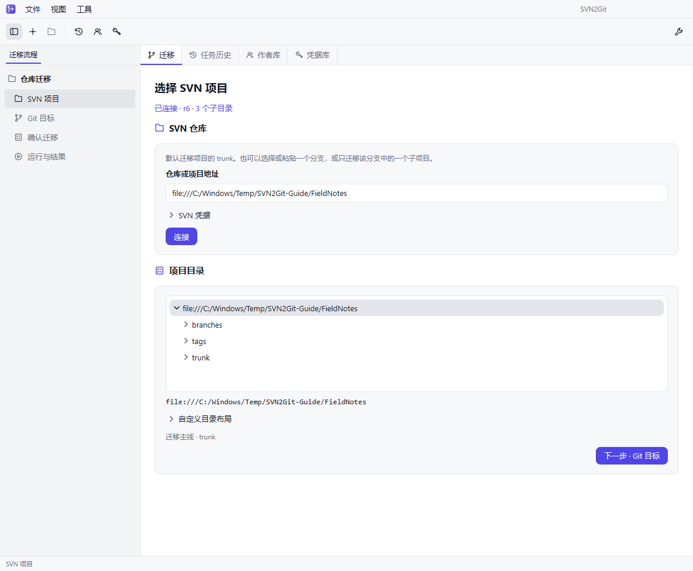
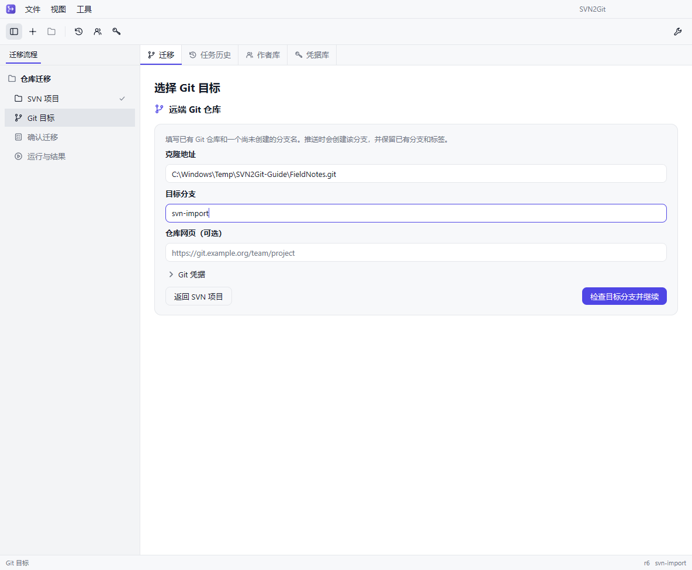
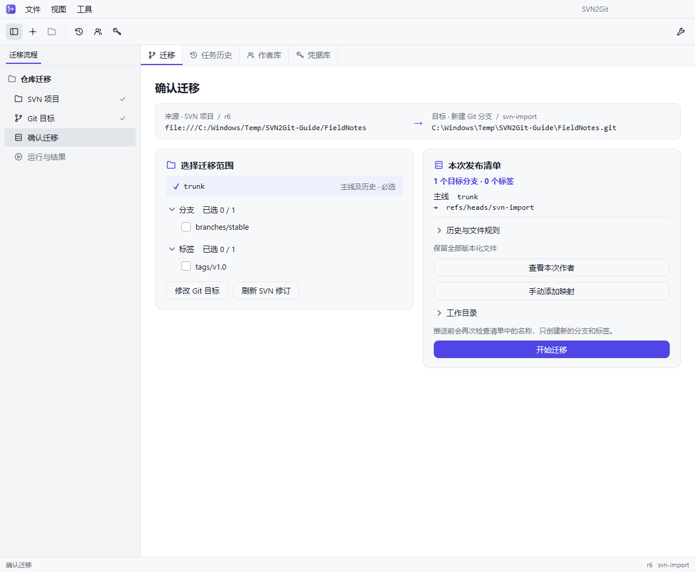
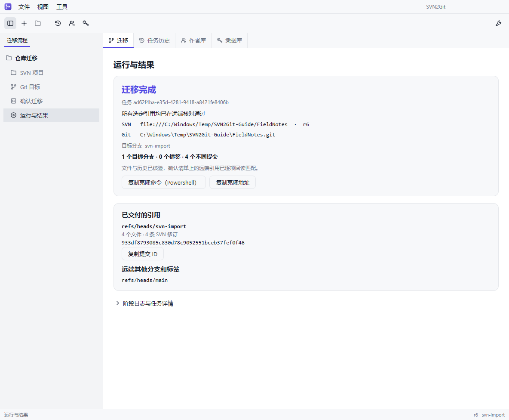
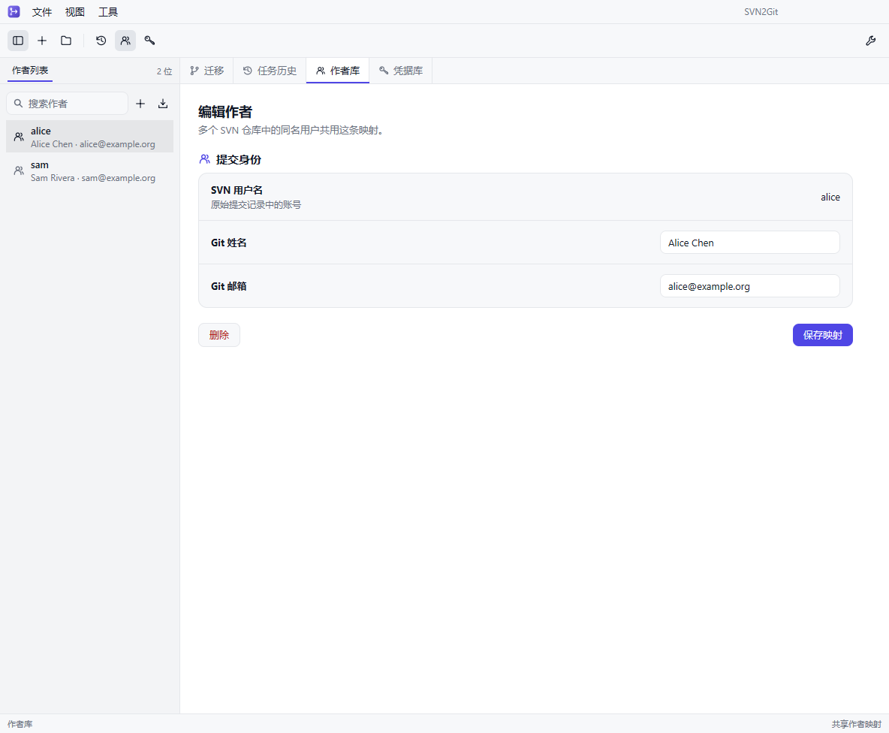
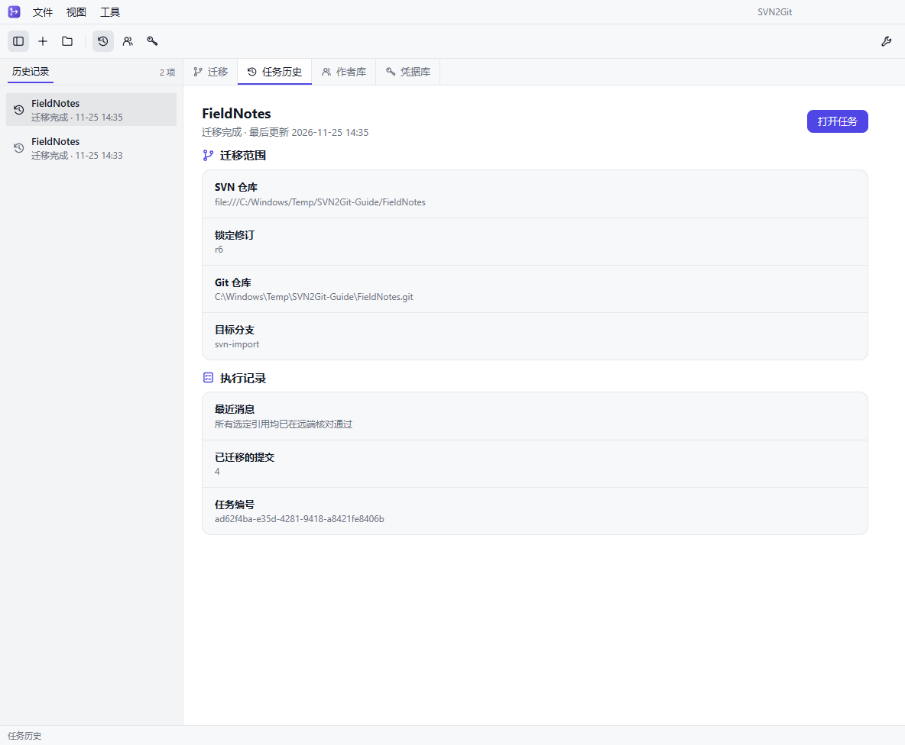

# SVN2Git

简体中文 · [English](README.en.md)

SVN2Git 是一款 Windows 桌面迁移工具。选中 SVN 项目后，可以把它的文件和提交历史迁到已有 Git 仓库的新分支。MyGo 原生向导列出每条 SVN 路径的去向，Rust 核心转换历史、校验文件，并在推送后逐项核对远端结果。

## 快速上手

1. 在 Windows 上准备 Git 和 Subversion 命令行工具。在 PowerShell 中运行 `git --version` 和 `svn --version --quiet`，确认都能显示版本号。使用 TortoiseSVN 时，可在安装程序中勾选 **Command line client tools**。
2. 从 [GitHub Releases](https://github.com/edisonluc/SVNHistoryToGit/releases/latest) 下载 `SVN2Git-windows-amd64.zip`（Windows x64）并解压。将 `SVN2Git.exe` 和 `svn2git-cli.exe` 放在同一目录，双击 `SVN2Git.exe`。也可以按[从源码构建](#从源码构建)自行打包。
3. 准备好可读取的 SVN 项目地址和可推送的 Git 仓库克隆地址。目标仓库可以是空仓库，也可以已有 `main` 等分支。为迁入的历史取一个新分支名，例如 `svn-import`，推送时向导会创建它。

## 跟着向导完成一次迁移

下面的截图来自一次本机示例迁移。示例把 `FieldNotes/trunk` 及其历史推到 `svn-import`，目标仓库已经有 `main`。实际操作时请填写自己的 SVN 和 Git 地址。

### 1. 选择 SVN 项目

在 **仓库或项目地址** 粘贴 SVN 地址，点 **连接**。在目录树中选中项目根目录，看一眼树下方显示的主线路径，再点 **下一步 · Git 目标**。标准项目默认使用 `trunk`。要迁移某个 SVN 分支或分支中的子项目，也可以直接选中它的目录。



### 2. 指定 Git 仓库和新分支

把 Git 仓库的 **克隆地址** 填入向导，在 **目标分支** 填写准备好的新名字。想从结果页直接查看代码，可以在 **仓库网页（可选）** 确认或补填网页地址。私有仓库可展开 **Git 凭据** 选择账号，然后点 **检查目标分支并继续**。



### 3. 核对本次发布清单

确认页会锁定一个 SVN 修订号，默认只迁移主线及其历史。想带上某个分支或标签，在 **选择迁移范围** 勾选对应路径，再看 **本次发布清单**。`refs/heads/` 开头的是 Git 分支，`refs/tags/` 开头的是 Git 标签。只迁主线时，清单应只有一个目标分支。

需要调整作者时点 **查看本次作者**。需要排除文件或启用 Git LFS 时展开 **历史与文件规则**。如果想纳入此时 SVN 中更新的提交，点 **刷新 SVN 修订**，重新核对清单后点 **开始迁移**。



### 4. 查看文件和提交历史

看到 **迁移完成** 后，在 **已交付的引用** 中查看每个分支或标签对应的提交 ID、文件数和 SVN 修订数。有仓库网页时点 **打开远端仓库**，切换到目标分支，查看文件列表和提交历史。也可以点 **复制克隆命令（PowerShell）**，在 PowerShell 中执行后进入克隆目录，运行 `git log --oneline` 查看提交。

示例使用本地 Git 仓库，可以用克隆命令验证。结果页显示 `svn-import` 有 4 个文件、4 条 SVN 修订，原有的 `main` 列在「远端其他分支和标签」中。



## 作者、凭据与任务历史

- **作者库**按 SVN 用户名在所有项目间共用映射。用 **导入 authors.txt** 可批量导入，每行形如 `alice = Alice Chen <alice@example.org>`。个别任务需要不同身份时，在确认页点 **查看本次作者 → 仅修改本次 → 应用到本次**。
- **凭据库**可保存 SVN 账号、Git HTTP(S) 令牌和 Git SSH 私钥路径，密码和令牌存入 Windows 凭据管理器。可在向导的 **SVN 凭据** 或 **Git 凭据** 中选用已保存的条目，也可使用当前用户已有的认证环境。
- **任务历史**中选择一条记录并点 **打开任务**，可以查看已交付的提交、展开 **阶段日志与任务详情** 或恢复失败的任务。桌面数据默认保存在 `%APPDATA%\SVN2Git`。在启动前设置 `SVN2GIT_DATA_DIR` 可更改位置。

<details>
<summary>查看作者映射和任务历史的界面</summary>

在作者库选择 SVN 用户名即可查看 Git 提交使用的姓名和邮箱。保存映射后，后续任务可复用这份身份。



在任务历史中选择记录，可以核对当时的 SVN 修订、目标分支和提交数。点「打开任务」可回到结果页。



</details>

## 常见问题

| 遇到的情况 | 操作 |
| --- | --- |
| 工具诊断提示缺少组件 | 在 **工具 → 工具诊断** 查看本次所需工具。常规桌面迁移只需 `svn` 和 `git`。勾选 Git LFS 时还需 `git lfs` 和支持 LFS 的远端。失败条目可打开安装说明、复制检测命令。补装后点 **重新检测**。如果安装程序修改了 `PATH`，从文件资源管理器重新打开应用。 |
| 所选项目找不到 `trunk` | 检查是否选中了正确的项目或分支。布局特殊时展开 **自定义目录布局**，填写相对所选项目的 **主线路径**。要把当前目录作为主线，可将主线路径留空。 |
| 目标分支或标签已存在 | 主线与已有分支重名时，在 Git 目标页改用新名称。可选分支、标签的目标名冲突时，在确认页修改对应名称或取消勾选。 |
| 推送中断，或推送后远端核对失败 | 从任务历史打开原任务并查看阶段日志。修复网络或写入权限后按页面提示点 **重试推送**。已经推送、等待复核时点 **重新核对远端**。 |

Git 不记录空目录和一般 SVN 属性。`svn:externals` 引用的外部项目需要单独迁移。

## 从源码构建

在 Windows 上准备 Go 1.27.3 或更高版本、Rust stable MSVC 工具链，以及包含 MSVC C++ 工具和 Windows SDK 的 Visual Studio Build Tools。在源码根目录打开 PowerShell，执行以下命令。

```powershell
.\build-desktop.ps1
& .\dist\SVN2Git\SVN2Git.exe
```

脚本会将两个可执行文件放进 `dist/SVN2Git/`，并生成 `dist/SVN2Git-windows-<GOARCH>.zip`。如果 Go 未加入 `PATH`，可用脚本参数 `-Go` 指定 `go.exe` 的完整路径。

## 项目结构与测试

| 目录 | 用途 |
| --- | --- |
| `desktop/` | Go / MyGo 原生界面、迁移向导和桌面协议客户端 |
| `crates/svn2git-core/` | SVN 探测、历史转换、校验、推送和存储 |
| `crates/svn2git-cli/` | 桌面协议服务和独立 CLI，支持诊断、配置文件迁移及报告导出 |

Rust 集成测试会创建本地临时仓库，需要从 `PATH` 调用 `git`、`svn`、`svnadmin`、`svnlook` 和 `svnmucc`。LFS 发布测试还会调用 `git lfs`。在项目根目录运行以下命令。

```powershell
cargo test --locked --workspace
go -C desktop test -buildvcs=false ./...
```

独立 CLI 默认使用当前目录下的 `.data`，可用全局选项 `--data-dir` 更改。在线快速导入还需要 `svnrdump`，兼容模式和增量同步需要 `git svn`，手工制作本地 SVN 转储可用 `svnadmin`。用 `cargo run --locked -p svn2git-cli -- --help` 查看命令，或将 `--help` 换成 `doctor` 查看工具诊断。

## 许可证

[MIT 许可证](LICENSE)
